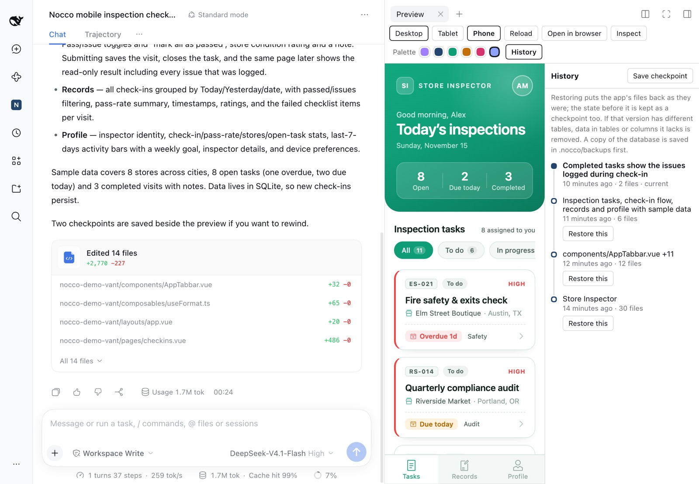
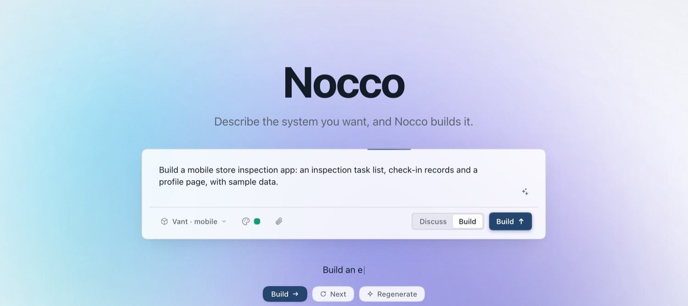
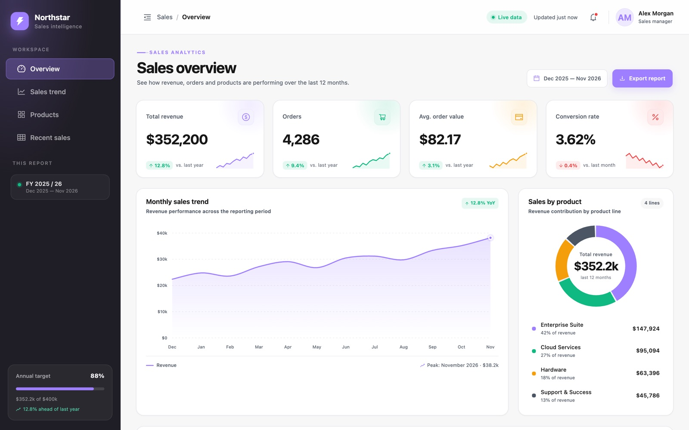
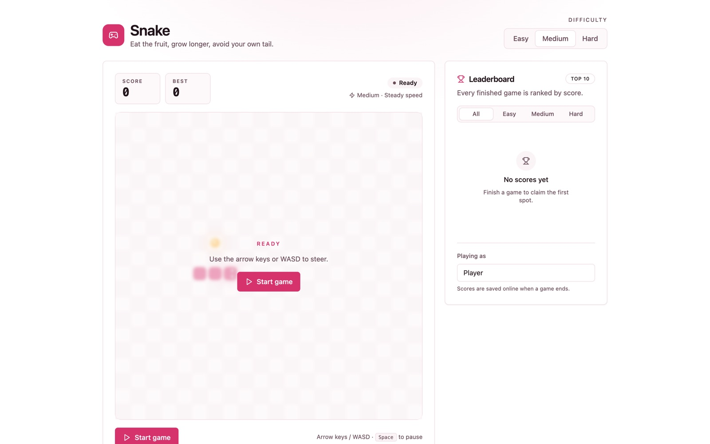
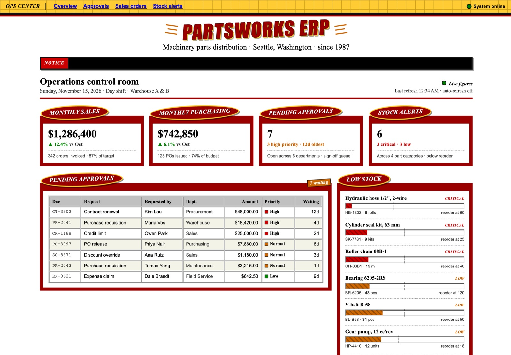
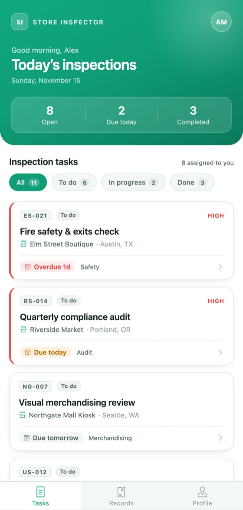

# Nocco: Web application developer workbench

English | [中文](README.zh.md)

Nocco turns DeepSeek Harness into a workbench for building web applications.
Describe the system you want; the agent builds it on your machine with the
model you choose, and you watch it, steer it and undo it from one place. No
account, no server, no extra cost beyond your own model.

## Why not just ask DSH to build a web app?

DSH can write a web app without any plugin. Nocco changes what that work is like:

| | Plain DSH | With Nocco |
| --- | --- | --- |
| Starting point | An empty folder; the model picks a stack and sets it up each time | A tested app with sign-in, roles and a database already working |
| Seeing the result | You start a dev server and open it yourself | A live preview opens beside the conversation, at desktop, tablet or phone width |
| Look and feel | Whatever the model decides that day | Four design systems, a colour scheme, font and style chosen before you build; recolour afterwards in one click, without the model |
| Your existing data | The model reads the file and retypes what it sees | Excel and CSV rows are loaded into the app as they are; the model only sees the columns |
| Saying what to change | Describe the element in words | Click it in the preview |
| Going back | No way to restore files | A timeline of checkpoints with one-click restore |
| Checking the work | The agent tests by its own means, or you find the error | Errors from the page you are looking at go straight back to the agent |

## What you can do with it

- **Build from a sentence.** Open Nocco in the sidebar, describe the system,
  press Build. The request goes straight to the agent, and the preview opens
  within about a minute while the rest is still being written.
- **Pick the look first.** Ant Design for admin systems, shadcn for modern web
  apps, Vant for phones, Retro for the 1990s web; plus a colour scheme, a
  font and style options.
- **Start from your own files.** Attach an Excel, CSV, Word or Markdown file
  and the system is built around it, with your rows as its starting data.
- **Real sign-in and real data.** Every app has accounts, roles and a SQLite
  database from the first minute. Games and public pages are created open,
  with no sign-in screen.
- **Point, don't describe.** Inspect lets you click an element in the preview;
  your next message tells the agent exactly which one, and which file draws it.
- **Undo anything.** History keeps a checkpoint of each piece of work.
  Restore one with a click; the restore can itself be undone.
- **Talk before building.** Switch to Discuss to plan the system with the
  agent before a single file is written.
- **Sharpen the request.** Enhance prompt rewrites a rough idea into a clear
  brief with your model; voice input dictates it when DSH's voice input is on.

## The Nocco page

The line under the box suggests systems to build. Your model writes the
suggestions from the names of your workspace files and recent sessions;
sample ideas are shown until it has.

## Design systems

| Ant Design · desktop admin | shadcn · modern web |
| --- | --- |
|  |  |

| Retro · 1990s web | Vant · mobile |
| --- | --- |
|  |  |

Every screenshot is an app the agent built from one request.

## What it adds to DSH

- Four design-system templates (Ant Design Vue, shadcn, Vant, and Retro, the
  look of a 1990s web page), each a Nuxt 3
  app that already has sign-in, roles and a SQLite database.
- Skill `nocco` (type `/nocco` in a session): how to build on the templates.
- Tool `nocco_scaffold`: creates the app in an empty directory, installs its
  dependencies and returns the first admin account.
- Tool `nocco_preview`: starts, stops and checks the app's local dev server,
  and applies the database schema whenever it changes.
- Tool `nocco_import`: reads an Excel, CSV, TSV, Word, Markdown or text file
  you want a system built from. For table files the model sees the columns
  and a few rows, while every row is saved into the app as a data file, so
  your data is loaded as it is rather than retyped by the model.
- Tool `nocco_checkpoint`: saves, lists and restores checkpoints of an app.
- A Nocco page in the sidebar, in the look of the Nocco web app (light and
  dark, following DSH's theme): describe a system, pick a design system and a
  colour scheme, font and style, attach files to build from, optionally let
  your model sharpen the request with Enhance prompt, and press Build, which
  opens a session and sends the request. Switch to Discuss to talk the plan
  through before anything is built. When DSH's voice input is enabled and
  ready, a microphone button dictates into the box. It suggests systems to build, written by your model from the
  names of your workspace files and recent sessions (sample ideas are shown
  when no model is configured).
- A preview tab beside the conversation with desktop, tablet and phone widths,
  reload, a palette picker that recolours the app without using the model,
  a History timeline of checkpoints with one-click restore, and Inspect: click
  an element in the preview to put it into your next message, so the agent
  knows exactly what you mean.

## Requirements

DSH 0.2.2-rc.1 or newer in the 0.2 line, Node 20 or newer, pnpm or npm, and
git for checkpoints.

## Install

    dsh plugin --profile web add @khglobal/dsh-nocco

In DSH Desktop, install it from Settings → Plugins instead.

## Use

Open Nocco in the sidebar, describe the system and press Build; the request
is sent to the agent straight away. Or type `/nocco` in any session. The agent asks for approval before it runs a tool.

## Data and sign-in

The agent creates an app with sign-in required when it is a system for
particular people, and with sign-in off when it is something anyone may open,
such as a game or a public page. Ask it to change this at any time.

Each app keeps its data in a `sqlite.db` file in its own folder. The first
admin account gets a random password when the app is created; the agent tells
you what it is. Passwords are stored hashed, and the session secret lives in
the app's `.env`, which is not committed.

## Checkpoints and undo

Open History in the preview tab to see the app's checkpoints as a timeline.
One is saved when the app is created, whenever the agent finishes a piece of
work, and when you press Save checkpoint. Restore any of them with one click;
the state before the restore is kept as a checkpoint too, so a restore can be
undone. You can also ask the agent to go back.

Checkpoints cover the app's files, not its stored data: the database, `.env`
and installed packages are not part of them. Code defines the tables,
though, so restoring a version with different tables removes data in the
tables or columns that version lacks. A copy of the database is saved under
`.nocco/backups/` before every restore (the last ten are kept). They are kept in a private git
store under `.nocco/` in the app folder, separate from any repository of your
own, and need git to be installed.

## Privacy

Suggestions are generated by sending the names of files and folders at the
top of your workspaces, and the titles of recent sessions, to the model you
have configured in DSH. File contents are not read for suggestions. Enhance
prompt sends the request you typed to the same model. Voice input is
transcribed by DSH's own speech service on your machine. A file you attach on the Nocco page is copied to a folder under your
system's temporary directory so the agent can read it. A file
you ask the agent to import is read on your machine; what the model sees of
it is described above. Nothing is sent anywhere else.

## Limits

No deploy or export. The generated app is not sandboxed: it is ordinary code
running a local dev server bound to 127.0.0.1.

## Development

    npm install
    npm test        # builds, then runs the unit tests
    npm run e2e     # real scaffold, install, Nuxt dev server and sign-in, per design system

## Licence

MIT. The app template in `resources/templates/` is MIT-0, so apps you build
carry no attribution requirement.
