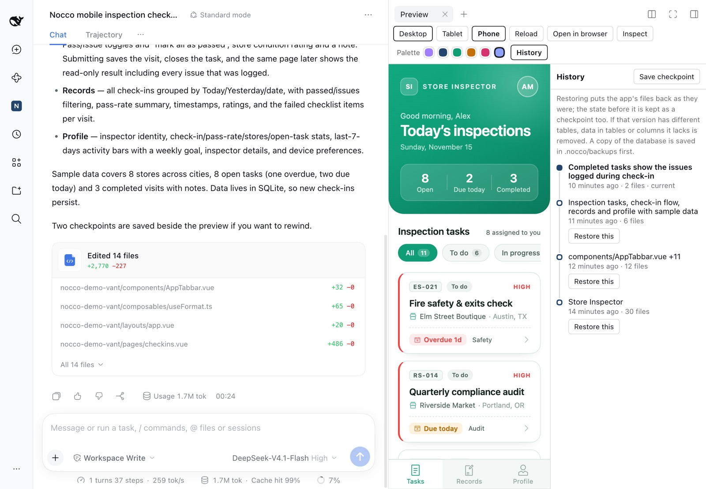
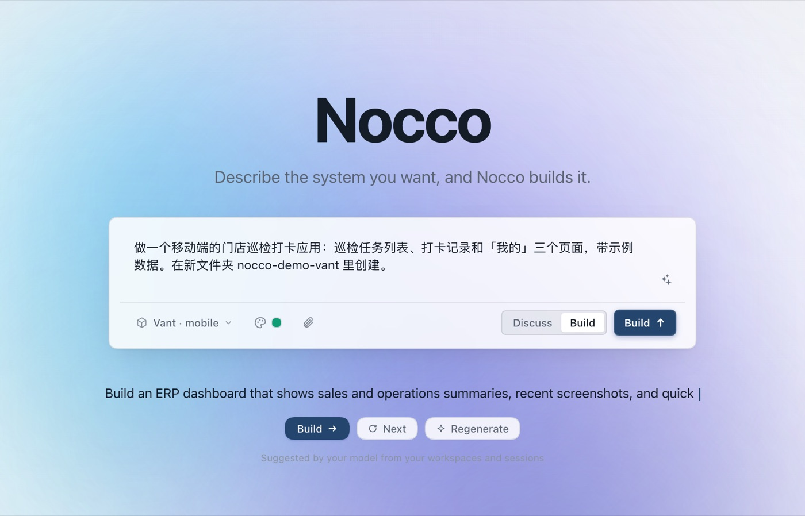
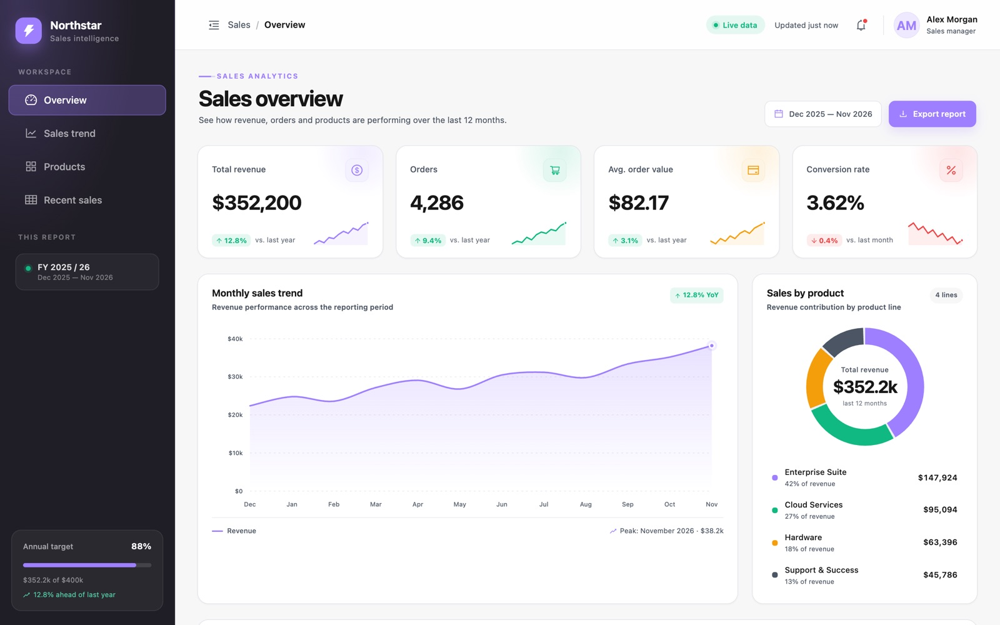
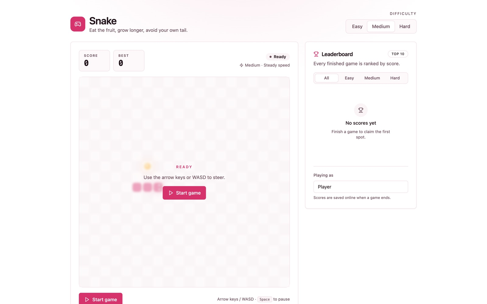
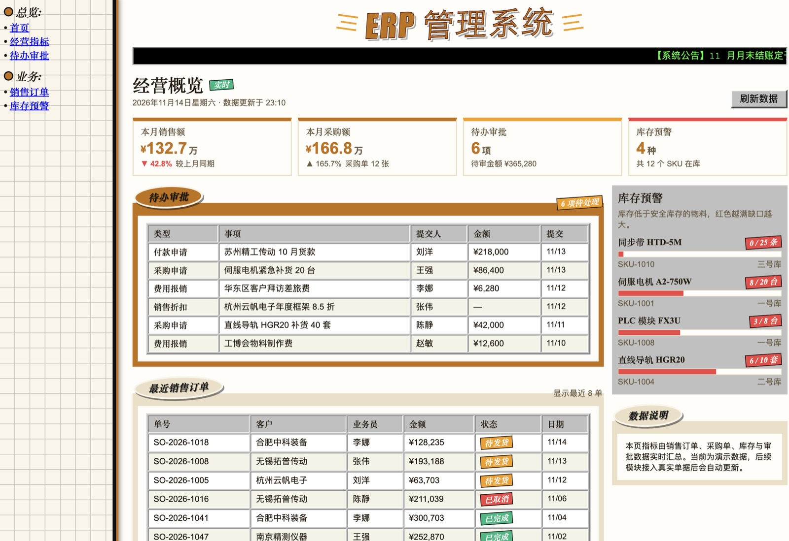
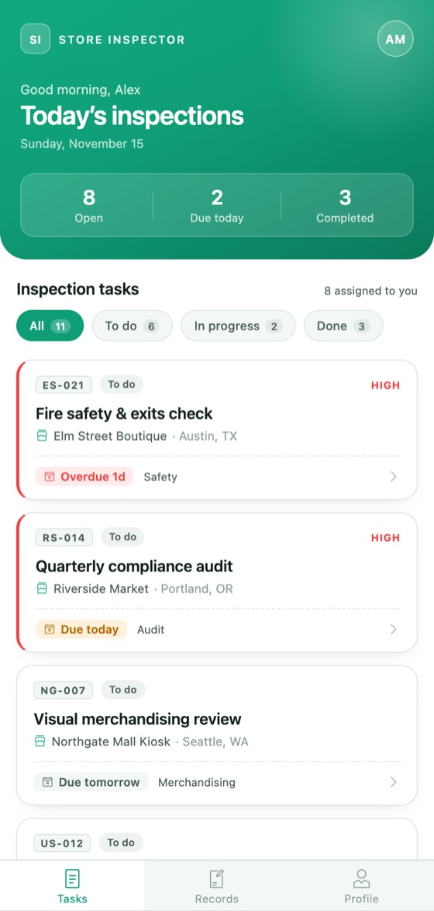

# Nocco：网页应用开发工作台

[English](README.md) | 中文

Nocco 把 DeepSeek Harness 变成一个构建网页应用的工作台。说出你想要的系统，Agent
就用你选的模型在你自己的电脑上把它做出来；预览、调整、撤销都在同一个界面里完成。
不需要账号，没有服务器，除了你自己的模型用量之外没有额外费用。

## 为什么不直接让 DSH 写一个网页应用？

不装任何插件，DSH 也能写网页应用。Nocco 改变的是这件事做起来的方式：

| | 原生 DSH | 使用 Nocco |
| --- | --- | --- |
| 起点 | 空文件夹，每次由模型自己选技术栈、搭环境 | 一个已经跑通登录、角色和数据库的应用 |
| 看到结果 | 自己启动开发服务器、自己打开浏览器 | 对话旁边自动打开实时预览，可切换桌面、平板、手机宽度 |
| 外观 | 看模型当天怎么发挥 | 构建前选好四套设计体系之一，以及配色、字体和界面风格；之后一键换色，不消耗模型 |
| 已有数据 | 模型读文件，再把看到的内容重新抄一遍 | Excel、CSV 的数据行原样载入应用，模型只看列结构 |
| 指出要改哪里 | 用文字描述那个元素 | 在预览里点一下 |
| 回退 | 没有恢复文件的办法 | 检查点时间线，一键恢复 |
| 检查结果 | Agent 自己想办法测试，或者你来发现报错 | 你正在看的页面一旦报错，会直接反馈给 Agent |

## 能做什么

- **一句话开始构建。** 打开侧栏的 Nocco，描述系统，点击「构建」。需求直接发给
  Agent，大约一分钟内预览就会打开，其余部分边写边出现。
- **先定外观。** 后台系统用 Ant Design，现代网页用 shadcn，手机端用 Vant，想要
  90 年代网页的味道用 Retro；还可以选配色、字体和界面风格。
- **从你自己的文件出发。** 添加 Excel、CSV、Word 或 Markdown 文件，系统就围绕它
  来建，你的数据行就是它的初始数据。
- **真实的登录和数据。** 每个应用从第一分钟起就有账号、角色和 SQLite 数据库。
  游戏、公开页面这类内容则直接打开，没有登录页。
- **用点的，不用描述。** 「选取元素」让你在预览里点中一个元素，下一条消息就会
  告诉 Agent 是哪一个、由哪个文件渲染。
- **随时撤销。** 「历史」为每一段工作保存检查点，一键恢复；恢复本身也能撤销。
- **先聊再建。** 切换到「讨论」，先和 Agent 把方案聊清楚，一个文件都不动。
- **把需求说清楚。** 「优化提示词」用你的模型把粗略的想法改写成清晰的需求；
  DSH 的语音输入开启时还可以直接口述。

## Nocco 页面

输入框下方会给出可以构建的系统建议，由你的模型根据工作区文件名和近期会话标题
生成；生成之前先显示示例想法。

## 设计体系

| Ant Design · 桌面后台 | shadcn · 现代网页 |
| --- | --- |
|  |  |

| Retro · 90 年代网页 | Vant · 移动端 |
| --- | --- |
|  |  |

每张截图都是 Agent 根据一句需求构建出来的应用。

## 为 DSH 增加的内容

- 四套设计体系模板（Ant Design Vue、shadcn、Vant，以及 90 年代网页风格的 Retro），每套都是自带登录、角色和
  SQLite 数据库的 Nuxt 3 应用。
- 技能 `nocco`（在会话里输入 `/nocco`）：说明如何在模板上构建。
- 工具 `nocco_scaffold`：在空目录里创建应用、安装依赖，并返回首个管理员账号。
- 工具 `nocco_preview`：启动、停止、检查应用的本机开发服务器，并在表结构变化时
  自动同步数据库。
- 工具 `nocco_import`：读取你想据此构建系统的 Excel、CSV、TSV、Word、Markdown
  或文本文件。对表格文件，模型只看到列和少量样例行，全部数据行则保存为应用内的
  数据文件，所以你的数据会原样载入，而不是由模型重新抄写。
- 工具 `nocco_checkpoint`：保存、列出和恢复应用的检查点。
- 侧栏里的 Nocco 页面，沿用 Nocco 网页版的外观（浅色与深色，跟随 DSH 主题）：描述
  系统、选择设计体系、配色、字体和界面风格，可添加作为依据的文件，可用「优化提示词」
  让模型把需求写得更清楚，点击「构建」即新建会话并发送需求；切换到「讨论」则先
  讨论方案、暂不构建。DSH 的语音输入已启用并就绪时，输入框会出现麦克风按钮，可直接口述。页面上的构建建议由你
  的模型根据工作区文件名和近期会话标题生成（未配置模型时显示示例想法）。
- 对话旁的预览页签：桌面、平板、手机三种宽度，刷新，不消耗模型的配色切换，
  可一键恢复的检查点历史时间线，以及「选取元素」：在预览里点一下要改的元素，它会
  写进你的下一条消息，Agent 就知道你指的是哪里。

## 环境要求

DSH 桌面版，0.2 系列的 0.2.2-rc.1 或更新版本。电脑上需要 Node 20 或更新版本、
pnpm 或 npm；检查点功能需要 git。

## 安装

包名是 `@khglobal/dsh-nocco`。在 DSH 桌面版里有三种安装方式：

- **直接让 DSH 安装。** 在任意会话里输入：

      安装插件 @khglobal/dsh-nocco

  Agent 会请求你批准几次，然后完成安装。「标准」和「创作者」模式下可用。
- **插件页面。** 打开侧栏的「插件」，点击「添加插件」，输入
  `@khglobal/dsh-nocco`，点击「安装」。
- **插件市场。** Nocco 上架社区插件索引之后，打开「插件」，进入「发现」页签，
  搜索 `Nocco`。

安装完成后，侧栏里马上会出现 Nocco。

DSH 网页版可以用命令行安装同一个包：

    dsh plugin --profile web add @khglobal/dsh-nocco

## 更新

打开「插件」，进入 Nocco。有新版本时页面会显示可用更新，点击「更新」即可。

## 使用

打开侧栏里的 Nocco，描述你要的系统并点击「构建」；也可以在任意会话里输入
`/nocco`。Agent 运行工具前会先请求你批准。

## 数据与登录

给特定人员使用的系统，Agent 会创建为需要登录；任何人都能打开的内容（如游戏、公开
页面）则创建为无需登录。你可以随时让它改。

每个应用的数据保存在它自己目录下的 `sqlite.db` 文件里。创建应用时会为首个管理员
生成随机密码，由 Agent 告诉你。密码以哈希形式保存，会话密钥放在应用的 `.env`
里，不会提交到版本库。

## 检查点与撤销

在预览页签里打开「历史」，可以看到应用检查点的时间线。创建应用时、Agent 每完成
一段工作时，以及你点击「保存检查点」时，都会保存一个检查点。任何一个都可以一键
恢复；恢复前的状态也会保留为检查点，所以恢复本身也能撤销。你也可以直接让 Agent
回退。

检查点只包含应用的文件，不包含已保存的数据：数据库、`.env` 和已安装的依赖不在
其中。但数据表由代码定义，所以恢复到数据表不同的版本时，那个版本没有的表或列里
的数据会被移除。每次恢复前都会在 `.nocco/backups/` 下保存一份数据库副本（保留
最近十份）。检查点保存在应用目录下 `.nocco/` 里的私有 git 仓库中，与你自己的仓库互不
影响。

## 权限

Nocco 的工具在调用它的会话的权限范围内工作，与 DSH 自身的文件和命令行工具遵循同一套权限。

- **写入位置。** 只在会话可写入的位置创建应用、保存检查点和写入导入的数据。在 DSH 的工作区模式下，
  就是会话的工作目录以及 DSH 授权的文件夹。通过链接指向外部的路径，按其实际指向的位置判断。
- **运行程序。** 安装依赖、开发服务器、数据库结构同步和检查点都在 DSH 的进程沙箱内运行，
  限制在同一位置。因此预览时应用自身的代码无法写入它所在文件夹之外的位置。
- **先询问。** 超出上述范围的操作，每次调用都需要你在 DSH 中批准，且批准只对该文件夹有效。
  只读会话、以及 DSH 无法限制程序的机器也是如此。批准被拒绝或无法询问时，不会写入或启动任何东西。
- **完全访问。** 你设为完全访问的会话不受限制，与 DSH 自身的工具一致。

读取你要求导入的文件时遵循 DSH 的规则：会话可以读取本机任意位置的文件。

## 隐私

生成建议时，会把各工作区顶层的文件和文件夹名称、近期会话的标题发送给你在 DSH 里
配置的模型。生成建议时不读取文件内容。「优化提示词」会把你输入的需求发送给同一个
模型。在 Nocco 页面添加的文件会复制到系统临时目录下的文件夹，供 Agent 读取。你让 Agent 导入的文件在本机读取，模型能
看到的部分如上所述。不会发送到其他任何地方。

## 限制

进程限制已在 macOS 上测试。在 Windows 和 Linux 上依赖 DSH 在这些系统上的沙箱，尚未与 Nocco 一起测试。

不含部署和导出。生成的应用是普通代码，开发服务器只监听 127.0.0.1。它的写入按「权限」一节所述受到限制；网络访问不受限制。

## 开发

    npm install
    npm test        # 先构建，再跑单元测试
    npm run e2e     # 按设计体系真实创建、安装、启动 Nuxt 开发服务器并登录

## 许可

MIT。`resources/templates/` 里的应用模板使用 MIT-0，你构建的应用不需要保留署名。
